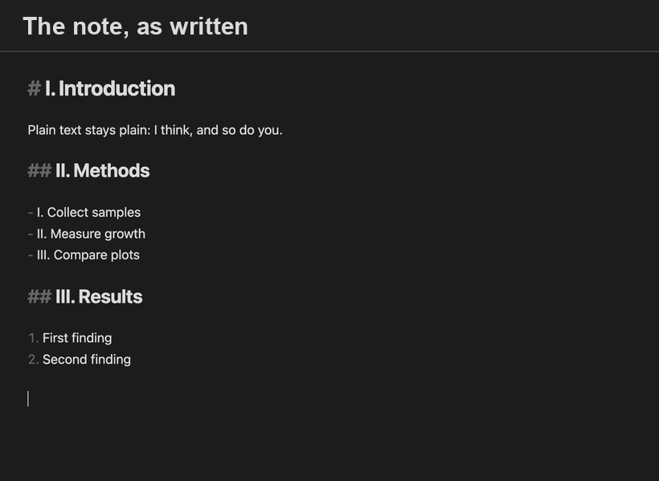
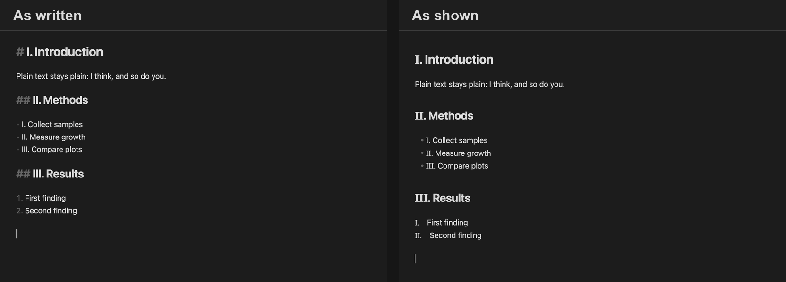

# Roman Numerals for Obsidian

Write `## IV. Methods` and see **## Ⅳ. Methods**.



Unicode has its own characters for Roman numerals (Ⅰ Ⅱ Ⅲ Ⅳ Ⅴ Ⅵ Ⅶ Ⅷ Ⅸ), separate from the letters I, V and X. This plugin shows your numerals as those characters in a serif face, so section numbers stand apart from ordinary text the way they do in academic writing.

## Why I built this

Academic papers, textbooks and formal reports have long numbered their sections with Roman numerals: Ⅰ. Introduction, Ⅱ. Methods, Ⅲ. Results. The numeral tells you at a glance that this is a section, not a quantity, a step or a list item. I wanted my notes to read the same way, with the structure separate from the numbers in the text.

Markdown has no way to do this. Typing `IV` gives you the letters I and V, which look like any other word, and numbered lists only come as 1, 2, 3. Unicode has proper numeral characters, but they're awkward to type, and some other Markdown apps and tools don't treat them the same way.

So this plugin lets you type plain letters and see real numerals. Your notes stay ordinary Markdown that reads correctly anywhere, and Obsidian shows them with the more formal headings and lists used in academic work.

## Two modes



| | Render (default) | Write |
|---|---|---|
| What's in the file | `IV.`, plain letters | `Ⅳ.`, the numeral character |
| What you see | Ⅳ. | Ⅳ. |
| Without the plugin | Reads as normal text | Still shows Ⅳ, in any app |
| Editing | The letters reappear under the cursor | Undo straight after a conversion brings the letters back |

Pick one under **Settings → Roman Numerals → Mode**. The plugin needs Obsidian 1.13 or later and works on desktop and mobile. Source mode always shows the file exactly as written.

## What counts as a numeral

The pronoun *I* and the maths *X* are everywhere, so the rules are strict. A numeral is recognised only:

- **at the start of a heading or list item:** `# I. Introduction`, `- II) Point`, `- [ ] III. Task`, including inside blockquotes and callouts
- **followed by a delimiter and a space** (or the end of the line). The default delimiters are `.` and `)`.

Or anywhere, when you **mark it**: `see part {IV}`. The markers are hidden in render mode and removed in write mode.

| You write | Becomes |
|---|---|
| `# I. Introduction` | # Ⅰ. Introduction |
| `- VIII) Point` | - Ⅷ) Point |
| `See part {VII}` | See part Ⅶ |
| `# I think so` | unchanged, no delimiter |
| `him and I.` | unchanged, not at the start of a heading or list |
| `- I.e. this` | unchanged, no space after the delimiter |
| `- X. Axis` | unchanged, a lone X is never a numeral |
| `` `{IV}` ``, `$x = {IV}$` | unchanged, code and maths are skipped, as are code blocks and frontmatter |

This version covers one to nine (I to IX). A lone X is never converted, only the exact token IX.

## Numbered lists

Set **Numbered lists** to Uppercase or Lowercase to show an ordinary numbered list with numerals:

```
1. First point      →   Ⅰ. First point      or   ⅰ. First point
2. Second point     →   Ⅱ. Second point     or   ⅱ. Second point
```

Lowercase pairs well with uppercase headings, as in academic outlines.

This is always on screen only, in both modes. Your note keeps `1.` and `2.`, so every Markdown app still sees a numbered list. Numbers from 10 on stay as numbers. Numbered lists in Reading view haven't been tested on iPhone or iPad yet.

## Write mode

- **As you type:** a heading or list numeral converts when you type the space after its delimiter. A marked numeral converts when you type the closing marker. Each conversion is its own undo step.
- **Commands** (in either mode, from the command palette):
  - *Write numeral characters into this note* converts everything the rules recognise.
  - *Change numeral characters in this note back to letters* turns every Ⅰ–Ⅸ back into I–IX, so you can switch back to render mode at any time.

Search matches what is in the file, so in write mode search for `Ⅳ` rather than `IV`.

## Settings

| Setting | Default | |
|---|---|---|
| Mode | Render | Render or write |
| Convert as you type | On | Write mode only |
| Headings | On | Recognise numerals at the start of headings |
| List items | On | Recognise numerals at the start of list items |
| Delimiters | `.)` | Characters that must follow a heading or list numeral |
| Markers | On | Recognise marked numerals anywhere |
| Marker prefix / suffix | `{` / `}` | Both are needed, and can't contain I, V or X |
| Include IX | On | Recognise IX as nine |
| Lowercase | Off | Also recognise `i.`, `ii.` … as ⅰ ⅱ … |
| Numbered lists | Off | Show `1.` to `9.` in numbered lists as Ⅰ. to Ⅸ. (uppercase) or ⅰ. to ⅸ. (lowercase) |

Reading view picks up setting changes the next time a note is opened.

## Styling

Numeral characters, written or rendered, carry the `roman-numeral` class and use a serif font by default. To choose another font, add a [CSS snippet](https://help.obsidian.md/snippets):

```css
body {
	--roman-numeral-font: "EB Garamond", serif;
}
```

## Installing

Until it is in the community list, either add `olivermichaelphillips/obsidian-roman-numerals` to [BRAT](https://github.com/TfTHacker/obsidian42-brat), or download `main.js`, `manifest.json` and `styles.css` from the latest release into `<vault>/.obsidian/plugins/roman-numerals/`, then turn the plugin on under **Settings → Community plugins**.

## Development

You need Node 22.18 or later, which runs the TypeScript tests directly.

```sh
npm install
npm run dev     # rebuilds main.js on every change
npm test        # the recognition rules, using Node's built-in test runner
npm run build   # type-check and production build
```

The code is in four small files:

- `src/numerals.ts` holds every recognition rule as plain string functions, with no Obsidian imports, so the tests cover exactly what both modes use.
- `src/render.ts` draws numerals in Live Preview and Reading view.
- `src/write.ts` converts as you type and applies the commands.
- `src/settings.ts` is the settings tab.

`src/main.ts` connects them.

## Licence

MIT
